<div align="center">

<picture>
  <source media="(prefers-color-scheme: dark)" srcset="docs/readme/logo-dark.svg">
  
</picture>

# VibeFlow OS

**English** · [Français](./README.fr.md)

### You talk. The team ships. You validate.

A Claude Code plugin for spec-driven agentic development. One agent reads your intent, a team
of agents challenges, plans, builds and proves the work, and machine gates check it.
Nothing is done without proof, nothing merges without you.

[](./VERSION)
[](#other-runtimes)
[](#modules)
[](./LICENSE)

[How it works](#how-it-works) · [Proof](#done-means-proven) · [Team](#a-team-not-a-chatbot) · [Memory](#memory-that-holds) · [Labs](#a-lab-for-any-domain) · [Install](#install) · [Manual](./manual/README.md)

</div>

https://github.com/user-attachments/assets/31709de8-a2c0-4e7c-b78e-8328f57e3f43

## Install

```bash
claude plugin marketplace add picmakpro/vibeflow-os
claude plugin install vibeflow
```

Then, inside Claude Code, run `/vibeflow-install`: it detects the scope, lets you pick modules,
and recaps every dependency before writing anything. Update with `/vf-update`. Codex and
kimi-code are covered [below](#other-runtimes); details in [INSTALL.md](./INSTALL.md).

New here? The [User Manual](./manual/README.md) walks you through installing, understanding and
running VibeFlow, without ever opening `.planning/` or `docs/`.

## How it works

<picture>
  <source media="(prefers-color-scheme: dark)" srcset="docs/readme/cycle-dark.svg">
  
</picture>

Say *"add Google sign-in"*. `vibeflow-head` reads the intent and launches the team. The request
is challenged with questions until it is clear, then it becomes a spec, a plan with tests first,
atomic commits, and a verdict from a judge that did not write the code. Every step leaves a file
on disk, so a session can die without the project losing ground. The last step is yours.

→ [The cycle, step by step](./manual/en/04-development-cycle/the-cycle-at-a-glance.md)

## Done means proven

<picture>
  <source media="(prefers-color-scheme: dark)" srcset="docs/readme/gates-dark.svg">
  
</picture>

A green that cannot turn red proves nothing. Tests are written red first, `check-*.sh` gates run
in CI, and the judge is never the author. The repo holds itself to the same rule: 104 suites run
on every push, and a "fresh lab" job installs the baseline into an empty lab that must pass its
own gates with zero intervention.

→ [The machine gates](./manual/en/07-under-the-hood/the-machine-gates.md)

## A team, not a chatbot

<picture>
  <source media="(prefers-color-scheme: dark)" srcset="docs/readme/team-dark.svg">
  
</picture>

*"Do steps 3 to 5, I'm back tomorrow."* Past a threshold, a mission manager takes over on the
team-kernel: it plans the battle as a graph, runs workers in parallel and reads typed reports
instead of prose. Anything that challenges intent or security freezes the node until you
decide, even at 3 AM.

→ [How a long mission holds together](./manual/en/05-agent-team/a-long-mission.md)

## Memory that holds

<picture>
  <source media="(prefers-color-scheme: dark)" srcset="docs/readme/memory-dark.svg">
  
</picture>

The context window fills and degrades; the disk does not. `PROJECT.md`, `ROADMAP.md`,
`STATE.md`, indexed registries and agent memory carry the project from one session to the
next. Every session restarts from a fresh disk, never from a compacted context, and every token
has a job: sonnet workers, digests, on-demand loading.

→ [Anatomy of an installed lab](./manual/en/07-under-the-hood/anatomy-of-an-installed-lab.md)

## A lab for any domain

<picture>
  <source media="(prefers-color-scheme: dark)" srcset="docs/readme/labs-dark.svg">
  
</picture>

VibeFlow is not dev-only. It builds labs, governed workspaces for design, content, growth,
business or your own domain, on the same kernel and the same gates. `/vf-new-lab` creates one,
and its skills are built by `skill-creator` with an eval loop.

→ [What is a lab?](./manual/en/02-concepts/what-is-a-lab.md)

## Modules

17 modules, each versioned with its own `CHANGELOG.md`. `conductor` is the mandatory baseline;
then you pick a dev lab from a preset (`dev`, `dev-mobile`, `dev-audite`, dependencies resolved
for you) or a tailor-made domain lab. Each module's README is its full documentation, with the
same structure everywhere.

→ [Module catalog](./manual/en/03-modules/catalog.md) ·
[commands](./manual/en/06-reference/commands.md) ·
[skills](./manual/en/06-reference/skills.md) ·
[agents](./manual/en/06-reference/agents.md)

## Other runtimes

Claude Code is the reference. Install **and** usage are also measured end to end on two others:

| Runtime | Install | What you give up |
|---|---|---|
| Codex | `codex plugin marketplace add picmakpro/vibeflow-os`<br>`codex plugin add vibeflow@vibeflow-os` | Hooks. Needs `multi_agent_v2` and a trusted repository, both fail silently otherwise; set `VF_RUNTIME=codex` if `claude` is also installed. |
| kimi-code | No install channel: load an agent with `kimi --agent-file <path>` | Hooks. |

Every loss is declared at install time rather than hidden. Full list:
[Installing outside Claude Code](./manual/en/01-get-started/other-runtimes.md).

## Trust

- **Source-available**: public code and history, see [LICENSE](./LICENSE).
- **Auditable**: bash + `jq`, every script covered by its suite, **idempotent** install with a
  backup before any overwrite.
- **Zero plugin-level hooks**: nothing runs until you invoke it. Module governance hooks are
  written by `/vibeflow-install`, in plain sight.
- **Anti-hallucination by design**: routing relies on a factual index generated from disk;
  incomplete modules are flagged `proposable:false`, never sold.

## Releases

Semver per module, and a tagged root version on every release (`check-release-tag` is a gate).
The three latest are below; the full history lives in **[CHANGELOG.md](./CHANGELOG.md)**.

| Version | Date | Change |
|---------|------|--------|
| `v2.70.0` | 2026-10-14 | **Driver lock per planning subject (minor).** In a split lab, two missions on different subjects no longer block each other: `driver-lock.sh --ws <subject>` locks one subject, `--depot` the whole repo, shared across worktrees. The guard and the mission exit gate follow; flat labs are unchanged apart from a stricter guard (`conductor` v1.49.0, `dev-orchestrator` v2.28.0). |
| `v2.69.1` | 2026-10-10 | **End-of-gesture guard fix (patch).** ROADMAP archiving no longer re-archives a block whose phase folders still exist (`conductor` v1.48.2). |
| `v2.69.0` | 2026-10-08 | **Planning partition chosen when a lab starts (minor).** New `vf-split-planning` skill, plus Pocock borrowings: question frontier, lab glossary, two-axis review. Closes the `fiabilite-v1.0` milestone. |

<details>
<summary><strong>Methodology references (ADR / LRN)</strong></summary>

- **ADR-032** — 4-pillar memory consolidation system
- **ADR-035** — AI-Safe software architecture doctrine
- **ADR-053** — Swarm layer: driver lock + DAG + typed reports
- **ADR-055** — Altitude boundary lab planning ↔ dev engine
- **ADR-056** — Runtime support vigilance
- **ADR-057** — Tooled boundaries with third-party bricks
- **LRN-101** — "Minimal agent + composable skills" pattern
- **LRN-106** — Audit before fix

Main lab (private): [vibeflow-lab](https://github.com/picmakpro/vibeflow-lab) — structural changes are tested there before release.

</details>

---

## Authors

- **[@picmakpro](https://github.com/picmakpro)** — creator of the VibeFlow methodology and repo owner. Laid the project's foundations and remains the guardian of its doctrine: the governance backbone (`conductor`, `planning-core`, `consolidator`), the scriptural hooks and guards that keep every lab honest. VibeFlow's identity — governance enforced by tools, not by prose — is his.
- **Samuel Neveu — [@samuel-neveugall](https://github.com/samuel-neveugall)** — the project's driving force day to day: main contributor and release driver. Built the entire development side (`dev-orchestrator`, `design-orchestrator`, `mobile-test-team`), led the agentic pivot and the team-kernel, and steers the framework's evolution — including its migration onto the `@opengsd/gsd-core` engine.

## Contributing

Contributions are welcome — no need to be a collaborator: fork, branch, open a pull request.
Read [CONTRIBUTING.md](./CONTRIBUTING.md) (workflow, tests, licensing of contributions), the
[Code of Conduct](./CODE_OF_CONDUCT.md), and report vulnerabilities privately as described in
[SECURITY.md](./SECURITY.md).

## License

Source-available under a proprietary license — see [LICENSE](./LICENSE). Public code and
history; training students get a private-reuse right; redistribution and resale prohibited.
The `skill-creator` module reuses original Anthropic content under the MIT license.
